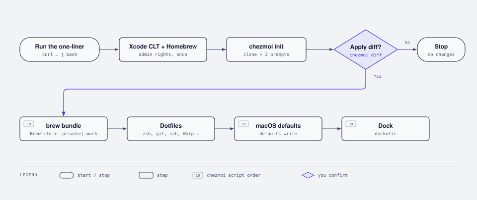
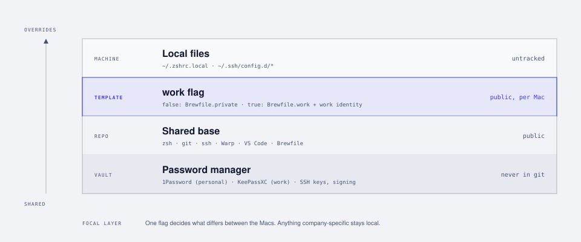

<div align="center">

# dotfiles

**One command from a fresh Mac to my desk.**<br>
My macOS setup, managed with chezmoi: one public repo for my personal and my work Mac, with secrets kept in 1Password.

[](https://github.com/nimble-123/dotfiles/releases/latest)
[](#quick-start)
[](https://chezmoi.io)
[](Brewfile)
[](#ssh--commit-signing)
[](#security)
[](https://www.conventionalcommits.org/en/v1.0.0/)
[](https://github.com/nimble-123/dotfiles/commits/main)

[Website](https://nimble-123.github.io/dotfiles/) · [Quick start](#quick-start) · [What's inside](#whats-inside) · [Personal vs. work](#personal-vs-work) · [Daily workflow](#daily-workflow) · [Security](#security) · [Releases](#releases) · [Manual steps](#manual-steps)

</div>

> [!NOTE]
> This repo is public on purpose, so nothing in it is secret: no private keys, tokens, internal hostnames or company URLs. Anything sensitive lives in [local, untracked files](#local-untracked-files) or in 1Password.

## Quick start

On a fresh Mac, run:

```bash
curl -fsSL https://raw.githubusercontent.com/nimble-123/dotfiles/main/bootstrap.sh | bash
```

That's it. The script installs Xcode Command Line Tools, Homebrew and chezmoi, clones this repo and asks three questions: your email, whether this is the work Mac, and your SSH signing key. Before it touches anything it shows `chezmoi diff` and waits for a **yes**. You can safely run it again at any time.

<picture>
  <source media="(prefers-color-scheme: dark)" srcset="docs/assets/bootstrap-dark.svg">
  
</picture>

> [!TIP]
> **No admin rights?** Homebrew needs them once, to create `/opt/homebrew`. If Homebrew is missing on a standard account, bootstrap stops and tells you what to ask IT for. Nothing else uses `sudo`.

## Why

- **One command.** A new Mac goes from setup assistant to a working terminal, editor and toolchain without a checklist of 40 installs.
- **Two Macs, one repo.** Shared defaults with a single `work` flag for the differences, so the personal and work setups don't drift apart.
- **Public, but safe.** Secrets stay in 1Password. Company specifics stay in local files. Every commit runs through gitleaks.
- **Diff before apply.** Nothing is overwritten silently.
- **Boring on purpose.** Plain chezmoi, plain Brewfiles and plain shell scripts, with no framework on top.

## What's inside

| | |
| --- | --- |
| **Shell** | zsh with [zinit](https://github.com/zdharma-continuum/zinit) (autosuggestions, syntax highlighting, fzf-tab), [starship](https://starship.rs) prompt, zoxide, direnv, fzf, nvm, plus modern aliases (`eza`, `bat`, `fd`, `rg`). zinit installs itself on first launch. |
| **Git** | Commits and tags signed with SSH through 1Password, `gh` as the credential helper, a global ignore file and short aliases. |
| **SSH** | Uses the 1Password SSH agent and lists only public hosts such as github.com. Everything else is pulled in from `~/.ssh/config.d/*`. |
| **Apps** | [Warp](https://warp.dev) `settings.toml`, VS Code `settings.json` plus 110 extensions, btop, fastfetch, linearmouse and hazelnut. |
| **Packages** | Three Brewfiles: [`Brewfile`](Brewfile) for both Macs, [`Brewfile.private`](Brewfile.private) and [`Brewfile.work`](Brewfile.work), each grouped by category. They cover formulae, casks, Mac App Store apps, VS Code extensions, and npm, uv and cargo tools. |
| **macOS** | Finder, Dock, keyboard, screenshots and save dialogs set via `defaults write`. MDM-tolerant: a locked setting is reported at the end instead of failing the run. |
| **Dock** | Layout and stacks via `dockutil`. Apps that aren't installed are skipped. |

### Repository layout

```text
.
├── bootstrap.sh                     # the one-liner target
├── Brewfile · Brewfile.private · Brewfile.work
├── .chezmoi.toml.tmpl               # prompts → ~/.config/chezmoi/chezmoi.toml (local)
├── .chezmoiignore                   # repo-only files, secrets, per-machine files
├── .chezmoiscripts/
│   ├── run_onchange_before_10-brew.sh.tmpl    # reruns when a Brewfile changes
│   ├── run_onchange_after_20-macos.sh.tmpl    # defaults write
│   └── run_onchange_after_30-dock.sh          # Dock layout
├── .githooks/                       # pre-commit (gitleaks), commit-msg (Conventional Commits)
├── .github/workflows/               # release-please
├── docs/                            # website + diagrams
├── dot_zshrc · dot_zprofile · dot_zshenv · dot_gitconfig.tmpl
├── create_dot_gitconfig.work.tmpl   # created once on the work Mac, then yours
├── dot_config/                      # starship, zsh, git, btop, fastfetch, …
├── dot_warp/settings.toml
├── private_dot_ssh/                 # ~/.ssh (700) and config (600)
└── private_Library/…/Code/User/settings.json
```

Scripts are `run_onchange`: each one embeds a hash of what it depends on and only runs again when that changes. Edit a Brewfile, run `chezmoi apply`, and only `brew bundle` runs.

## Personal vs. work

<picture>
  <source media="(prefers-color-scheme: dark)" srcset="docs/assets/layers-dark.svg">
  
</picture>

On the first `chezmoi init` you're asked a few questions. The answers are stored **only locally** in `~/.config/chezmoi/chezmoi.toml`, never in this repo.

| Variable | What it does |
| --- | --- |
| `work` | `true` on the work Mac: installs `Brewfile.work` instead of `Brewfile.private`, adds the `includeIf` for `~/work/` and creates `~/.gitconfig.work` |
| `email` | Personal Git email, the default for every repo |
| `workEmail` | Work Mac only: the email for repos under `~/work/` |
| `sshSigningKey` | Public key from 1Password used to sign commits |

Templates branch on the flag with `{{ if .work }} … {{ end }}`, and `.chezmoiignore` decides which files exist on which Mac. To change an answer later, run `chezmoi edit-config` and then `chezmoi apply`.

### Local, untracked files

Company-specific things such as hostnames, IPs, proxies, registry URLs or internal workflows go here and **never** into the repo:

| File | Purpose |
| --- | --- |
| `~/.zshrc.local` | Proxy settings, internal aliases, environment variables. Sourced last by `.zshrc` |
| `~/.ssh/config.d/*` | Company and internal SSH hosts. Included at the top of `~/.ssh/config` |
| `~/.gitconfig.work` | Work email and signing key for everything under `~/work/`. Created once by chezmoi, then never touched again |
| `~/.gitconfig.local` | Any other Git overrides for this machine |

## Daily workflow

| Task | Command |
| --- | --- |
| Track a new file | `chezmoi add ~/.config/foo/config` |
| Edit a tracked file | `chezmoi edit ~/.zshrc`, or edit in place and run `chezmoi re-add` |
| Preview changes | `chezmoi diff` |
| Apply | `chezmoi apply` |
| Jump into the repo | `chezmoi cd` |
| Commit and push | `git add -A && git commit -m "…" && git push` |
| Pull on the other Mac | `chezmoi update` |

**Adding an app:** put it in the right Brewfile, commit, then run `chezmoi apply`. The brew script picks up the changed hash and runs `brew bundle`.

## SSH & commit signing

There are no private keys on disk. The 1Password SSH agent serves them, and every commit is signed with the same key:

```ini
[gpg]
  format = ssh
[gpg "ssh"]
  program = /Applications/1Password.app/Contents/MacOS/op-ssh-sign
[commit]
  gpgsign = true
```

The work Mac can use a different 1Password account and key. Set `signingkey` in `~/.gitconfig.work`, and it applies to every repo under `~/work/`.

## Security

- **Secrets only via 1Password:** `{{ onepasswordRead "op://Vault/Item/field" }}` in a template, never in plain text.
- **Pre-commit hook:** [`.githooks/pre-commit`](.githooks/pre-commit) runs `gitleaks` on every staged change. `bootstrap.sh` turns the hooks on with `git config core.hooksPath .githooks`.
- **Full history scan:** `gitleaks git .`
- **Ignored by design:** `~/.ssh` keys and `known_hosts`, `gh`, `op` and `gnupg` config.

## Releases

Versions and the [changelog](CHANGELOG.md) are generated by [release-please](https://github.com/googleapis/release-please) from commit messages, so every commit follows [Conventional Commits](https://www.conventionalcommits.org/en/v1.0.0/):

```text
feat(brew): add raycast
fix(macos): keep key repeat on MDM-managed Macs
docs: explain the work flag
```

| Type | Effect |
| --- | --- |
| `feat` | minor release, listed under Features |
| `fix` | patch release, listed under Bug Fixes |
| `feat!` or a `BREAKING CHANGE:` footer | major release |
| `docs`, `refactor`, `perf`, `build` | listed in the changelog |
| `ci`, `chore`, `style`, `test` | hidden |

A `commit-msg` hook in [`.githooks/`](.githooks/) rejects anything else. After each push to `main`, release-please keeps a release PR open. Merging it tags the version and publishes the GitHub release.

## Manual steps

Some things can't be scripted (yet):

- [ ] **1Password:** sign in, then Settings → Developer → turn on **SSH agent** and **CLI integration**
- [ ] Add the SSH key to GitHub as both an **authentication** and a **signing** key, then run `ssh -T git@github.com`
- [ ] **Warp:** Settings → Account → turn **Settings Sync off**, so it doesn't fight chezmoi
- [ ] **VS Code:** leave Settings Sync off, since chezmoi owns `settings.json`
- [ ] Sign in to the **App Store**, then rerun `chezmoi apply` if any `mas` apps are missing
- [ ] **Privacy permissions:** Accessibility (alt-tab, linearmouse, Amphetamine), Screen Recording (shottr, OBS), Full Disk Access (Warp)
- [ ] **Logins & licences:** `gh auth login`, Claude, ChatGPT, MoneyMoney, gifox
- [ ] Apps with their own cloud sync: 1Password, Obsidian, Raycast, Slack
- [ ] Optional Rust: `curl https://sh.rustup.rs -sSf | sh`, then `chezmoi apply` for the cargo tools

<div align="center">
<sub>Built with <a href="https://chezmoi.io">chezmoi</a>. Feel free to borrow anything that's useful to you.</sub>
</div>
